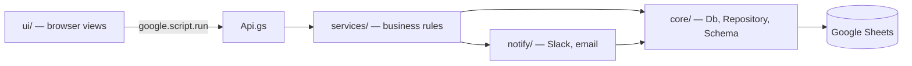

# Leave Desk

Leave management for Darukaa.Earth, built on Google Workspace.

- **Database:** Google Sheets (one tab = one table)
- **Backend:** Google Apps Script (V8)
- **Frontend:** Apps Script web app (HtmlService, plain JavaScript, no framework)
- **Notifications:** Slack incoming webhook, email as fallback

## Rules the code implements

| Who applies | Who is asked | Outcome |
|---|---|---|
| Employee | Team Lead **and** team C-suite, at the same time | First approval approves; any rejection rejects (until the leave starts) |
| Team Lead | Their team's C-suite (Ankita → Vikram, Jaya/Gaurav → Guneet) | Single approver |
| C-suite | Nobody | Approved automatically and logged |

- Over quota is allowed with a warning; extra days become **Loss of Pay**.
- Weekends and the Holidays tab are not counted. Half day = 0.5.
- Every decision is stored with its own timestamp; every change goes to AuditLog.

## Architecture



Each layer only calls the layer below it.

```
src/
├─ appsscript.json          manifest (time zone, V8, web app settings)
├─ WebApp.gs                doGet() + include() for HTML files
├─ Api.gs                   the only functions the browser calls; thin, no rules
├─ core/                    reusable foundation, no leave logic
│  ├─ Schema.gs             every table + column + type (single source of truth)
│  ├─ Repository.gs         generic CRUD on one tab, columns matched by name
│  ├─ Db.gs                 Db.table(name), Db.transaction(fn) with a script lock
│  ├─ Codec.gs              cell ⇄ value conversion (dates as yyyy-MM-dd strings)
│  ├─ DateUtil.gs           working days, quarters, overlaps (pure functions)
│  └─ Errors.gs             AppError: messages users can read
├─ services/                business rules, one job per file
│  ├─ Config.gs             typed access to the Settings tab
│  ├─ Directory.gs          employees, teams, safe profile()
│  ├─ Catalog.gs            leave types, holidays, weekend days
│  ├─ Identity.gs           signed-in user, admin check, test-mode "view as"
│  ├─ BalanceService.gs     hold → commit / release / revert; paid vs LOP split
│  ├─ ApprovalRouter.gs     WHO approves (strategy per rule in ApprovalFlow)
│  ├─ DecisionPolicy.gs     decisions → status (ANY_ONE / ALL), lock on start date
│  ├─ LeaveService.gs       requester: preview, submit, cancel, list
│  ├─ ApprovalService.gs    approver: inbox, decide, parallel approval rows
│  ├─ RequestView.gs        client-facing shape of a request
│  └─ Audit.gs              append-only AuditLog
├─ notify/
│  ├─ Messages.gs           WHAT to say per event (channel-neutral templates)
│  ├─ SlackChannel.gs       HOW: Slack Block Kit via webhook
│  ├─ EmailChannel.gs       HOW: MailApp
│  └─ Notifier.gs           tries channels in order; never breaks a saved request
├─ setup/
│  ├─ Setup.gs              Leave Desk menu, setupDatabase / reset / check
│  ├─ SheetFormatter.gs     headers, notes, dropdowns, checkboxes, README tab
│  └─ Seed.gs               dummy data (balances computed, so tabs agree)
└─ ui/
   ├─ Index.html            page shell; includes everything below
   ├─ Styles.html           design tokens + styles
   └─ js/
      ├─ Dom.html           h() element builder, formatters, toast
      ├─ Api.html           Promise wrapper around google.script.run
      ├─ Store.html         page state + subscribe
      ├─ Components.html    BalanceCard, RequestCard, ApprovalTrail, StatusChip…
      ├─ App.html           frame, nav, test bar, actions, rendering
      └─ views/             Overview, Apply, Requests, Approvals
```

### Design principles

| Principle | Where you see it |
|---|---|
| Single responsibility | One job per file: routing, decision rules, balances and notifications are each separate. |
| Open/closed | New approver kind → one entry in `ApprovalRouter.RULES`. New approval rule → `DecisionPolicy`. New channel (Teams, WhatsApp) → one object in `Notifier.CHANNELS`. New event → one template in `Messages`. |
| Liskov / interface segregation | Every channel has the same small interface `{ name, isEnabled(), send(msg) }`. |
| Dependency inversion | Services use `Db.table()`, never `SpreadsheetApp`. Views use `actions`, never `google.script.run`. |
| GRASP Information Expert | `BalanceService` owns balance maths; `DecisionPolicy` owns status rules. |
| GRASP Controller | `Api.gs` endpoints are thin controllers; the UI's controller is `App.html`. |
| GRASP Pure Fabrication | `Repository`, `Codec`, `Notifier`, `RequestView`. |
| DRY | `quote()` is shared by preview and submit; Components are shared by every view; the schema is defined once. |

## Install

### Option A — clasp (recommended, works with GitHub)

1. Install clasp: `npm install -g @google/clasp`. It needs Node 22 or later.
2. Turn on the Apps Script API at https://script.google.com/home/usersettings.
3. Run `clasp login`.
4. Find the Script ID: open the sheet → **Extensions → Apps Script** → ⚙ **Project Settings** → **Script ID**.
5. Copy `.clasp.json.example` to `.clasp.json` and paste the Script ID into it.
6. Run `clasp push`. It replaces all files in the project, including the old `Setup.gs` and `Code.gs`.

### Option B — by hand in the editor

1. Delete the old **Setup.gs** and **Code.gs**. Their names would clash with the new files.
2. Add every file from `src/` using **+ → Script** (for `.gs`) or **+ → HTML** (for `.html`).
3. Type the folder path as part of the name, for example `core/Db` or `ui/js/views/Apply`. The editor adds the extension itself.
4. Show `appsscript.json`: ⚙ Project Settings → tick **Show "appsscript.json" manifest file in editor**. Then paste its contents.

### Then, either way

1. In the editor, run **setupDatabase** once.
   - It links the web app to this spreadsheet (the `SPREADSHEET_ID` Script Property).
   - It adds the `TEST_MODE` setting.
   - It asks you to approve new permissions: email, Slack calls.
   - Existing data is kept.
2. Run **Deploy → Test deployments → Web app** and open the `/dev` URL. It always runs the latest saved code.
3. For the team:
   - **Deploy → New deployment → Web app**, with *Execute as:* **Me** and *Who has access:* **Anyone within Darukaa.Earth**.
   - Put the URL in **Settings → APP_URL** so "Open request" buttons work.
   - After later code changes, use **Manage deployments → Edit → New version**.

## Testing with test mode

Gmail accounts outside the Darukaa domain can't be identified by a web app, so testing uses **View as** instead.

1. Open the app as an admin (`Settings.ADMIN_EMAILS`).
2. Use the yellow **Test mode** bar to switch between people:
   - **Shiva:** apply for leave.
   - **Jaya:** approve it.
   - **Guneet:** add a second approval or reject it.
   - **Ankita:** a lead request, which goes to Vikram only.
   - **Vikram:** C-suite, auto-approved.
   - **Arshad:** over quota.
3. While Slack is off, emails go to the test accounts in `LD_CONFIG.TEST_EMAILS`.
4. Before go-live, set `TEST_MODE` to FALSE.

## Google sign-in (any Google account)

1. In Google Cloud Console, create an **OAuth client ID** of type **Web application**.
   - Authorized redirect URI = the web app `/exec` URL, which must match `Settings.APP_URL` exactly.
2. Set the OAuth consent screen audience to **External**. While it's in **Testing**, add the testers' emails as test users. Publish it to let any Google account in. Scopes are only `openid email profile`, so Google doesn't need to verify the app.
3. In Apps Script, go to ⚙ Project Settings → **Script Properties** and set `OAUTH_CLIENT_ID` and `OAUTH_CLIENT_SECRET`.
4. Deploy the web app with *Execute as:* **Me** and *Who has access:* **Anyone**. Later updates use **Manage deployments → Edit → New version**, which keeps the same URL.

How it works: `services/Auth.gs` runs the OAuth authorization-code flow.
- A one-time `state` value prevents forged sign-ins.
- The server exchanges the code for an ID token and checks it: `aud`, `iss`, `exp` and `email_verified`.
- It opens a 6-hour session in CacheService. The browser sends the session with every API call.
- The email is then matched to the Employees tab.

Without the two Script Properties, the app falls back to the Google session (same-domain only).

## Turning on Slack

1. Create a Slack app with an **Incoming Webhook** for `#leave-requests`.
2. In Apps Script: ⚙ Project Settings → **Script Properties** → set `SLACK_WEBHOOK_URL`.
3. In the sheet, set `Settings.SLACK_ENABLED` to TRUE.
4. Optional: fill `Employees.slack_user_id` so messages @mention people.

## Local tests

```
node test/flow.test.js   # backend end to end against in-memory Apps Script mocks
node test/render.js      # screenshots of every view (needs Playwright)
```

The flow test covers: setup is safe to re-run; preview and validation; parallel approval; a second approval being recorded; reject after approve; the lock once leave starts; cancel; lead and C-suite routing; over quota → LOP; access control; Slack-then-email fallback; and every balance reconciling with its requests. Files are loaded in random order, which proves nothing depends on the order Apps Script loads them in.

## Next (Phase 3)

- Admin page: people, teams, leave types, policies, approvers, balance adjustments
- Quarterly accrual trigger and year-end expiry
- Reports: Excel / PDF / CSV
